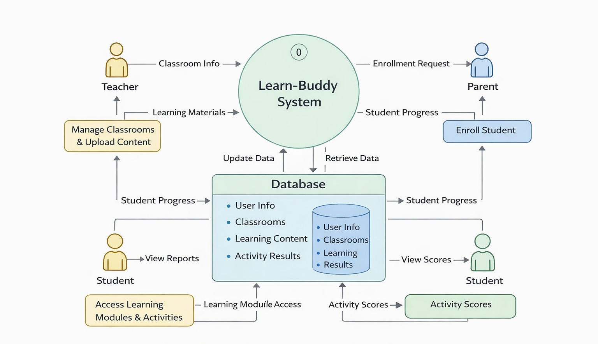
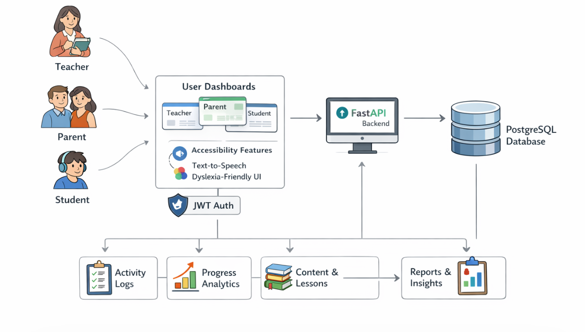
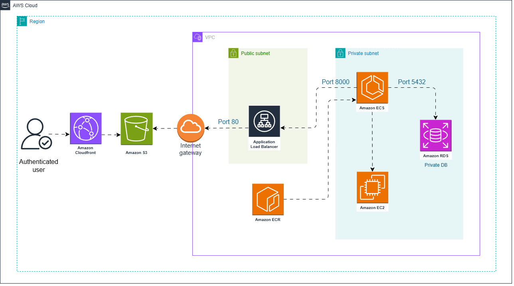
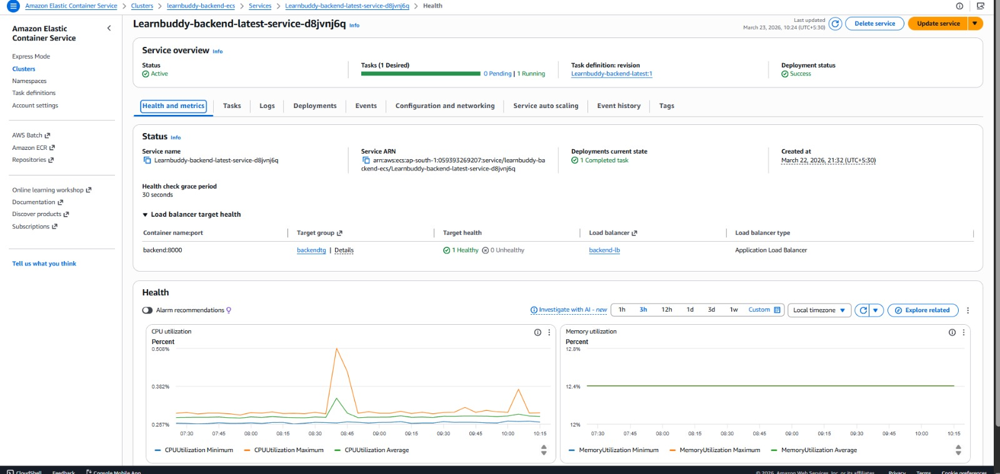
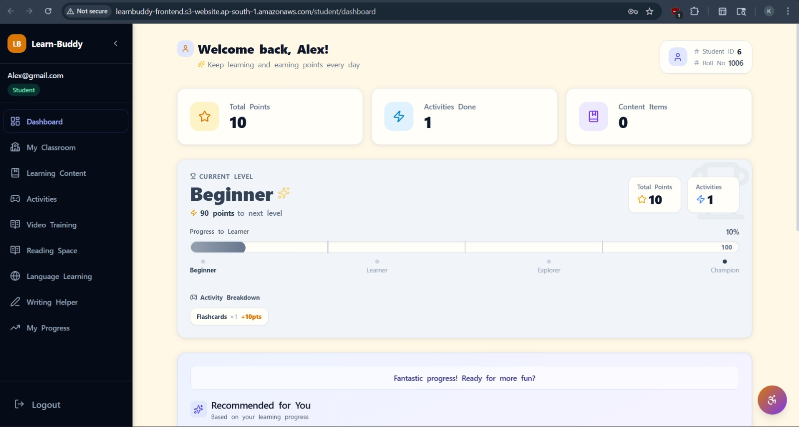
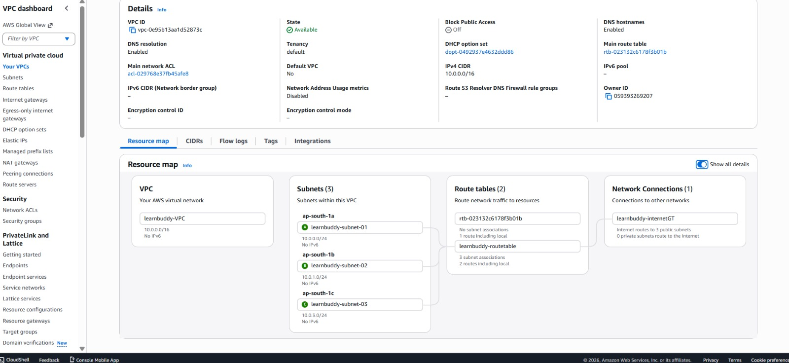

<div align="center">
  <h1>Learn-Buddy</h1>
  <p>Learn-Buddy is a dyslexia-friendly learning platform for Teachers, Parents, and Students.</p>
  <p>
    
    
    
    
  </p>
</div>

---

## Core Summary

- Frontend: React SPA with student/teacher/parent dashboards
- Backend: FastAPI REST API with authentication and authorization
- Data: PostgreSQL persistence with activity logs and progress analytics
- Access: JWT security and role-based route guards
- Accessibility: Text-to-speech plus dyslexia-friendly UI

---


### Backend


``` bash
cd auth
python -m venv .venv
.venv\Scripts\activate
pip install -r requirements.txt
uvicorn app.main:app --reload
```

### Frontend


```bash
cd frontend
npm install
npm start
```

### Environment variables

>**Backend (`auth/.env`)**

```ini
SQLALCHEMY_DATABASE_URL=postgresql://postgres:<password>@localhost/demo
SECRET_KEY=YOUR_SECRET_KEY
ALGORITHM=HS256
ACCESS_TOKEN_EXPIRE_MINUTES=300000
```

>**Frontend (`frontend/.env`)**

```ini
REACT_APP_API_URL=http://localhost:8000
REACT_APP_CLOUDINARY_CLOUD_NAME=<your-cloud>
REACT_APP_CLOUDINARY_UPLOAD_PRESET=<your-preset>
```

---
<div align=center>
<h1> Architecture diagram </h1>

<!--  -->


- Layout: user interfaces, API endpoints, database storage, monitoring.
---
</div>

## Workflow (Process)

1. **Teacher** creates classrooms and learning materials.
2. **Parent** adds students and enrolls them into classrooms.
3. **Student** uses activities, reading space, and writing helper.
4. **System** captures points and updates progress tracking.

---

<h1 align=left> Cloud Deployment architecture </h1>




- CI/CD pipeline and deployment routing for cloud environment.

### ECS status



- Cluster service health, tasks, and runtime metrics.

### Frontend status



- Application endpoint, load balancer, and performance overview.

### Network topology



- VPC configuration, subnets, routing and security gateway overview.

---

## Role-specific features

- **Teacher**: manage classrooms, content, scores, vocabulary.
- **Parent**: manage students, enrollment, progress insights.
- **Student**: practice activities, reading/writing support, points.

---

## Deployment notes

- Store secrets securely for production deployments.
- Ensure CORS is configured for deployed frontend domain.
- Run migrations before launching.
- Monitor logs and metrics in production environment.

---

## License

See `LICENSE` for terms.

